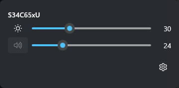
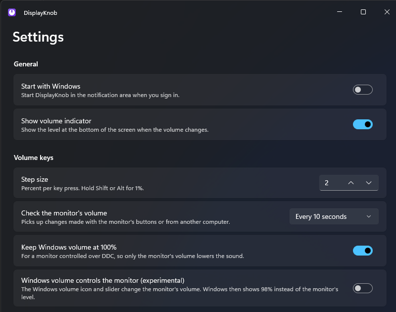

<p align="center">
  
</p>

<p align="center">
  <a href="LICENSE"></a>
  
  
  <a href="../../releases/latest"></a>
</p>

<p align="center">
  <a href="#install">Download</a> ·
  <a href="#features">Features</a> ·
  <a href="#troubleshooting">Troubleshooting</a> ·
  <a href="#roadmap">Roadmap</a> ·
  <a href="#contributing">Contributing</a>
</p>

## Why

DisplayKnob is an open-source hub for managing your displays from the Windows tray. It talks to monitors over DDC/CI, so it can change settings that Windows itself can't reach.

It starts with volume. Share one monitor between a Mac and a Windows PC through a KVM, and the two machines disagree about it: the Mac's volume keys change the **monitor's own volume**, while Windows only turns audio down in software. DisplayKnob makes the Windows volume keys drive the monitor's hardware volume too, so both machines agree.

Brightness is already there. Input switching, display presets and more are on the [roadmap](#roadmap). No drivers, no admin rights.

<!--
TODO: screenshots. Add two images to docs/assets/ and uncomment.

|  |  |
|:---:|:---:|
| Click the tray icon for volume and brightness sliders. The knob's pointer follows the volume. | Per-monitor limit and curve, shortcuts, audio output mapping. |
-->

## Features

Volume is where DisplayKnob starts, and it is built to be the best at it. The same foundation (monitor discovery, a KVM-proof DDC layer, a tray UI) carries everything that comes next.

| | |
|---|---|
| **Hardware volume keys**<br>The media keys drive the monitor's volume over DDC/CI, so a KVM-shared monitor stays in sync with the Mac. | **Mute that sticks**<br>Uses the monitor's own mute, or falls back to volume 0 when it has none. |
| **Follows your audio output**<br>Controls whichever monitor is playing sound. With headphones selected, the keys behave normally. | **Volume and brightness, one click away**<br>Sliders for every monitor in a tray flyout. The knob in the tray shows the volume. |
| **Limit and curve, per monitor**<br>Cap the maximum volume and choose a linear or logarithmic curve for finer steps at the quiet end. | **Shortcuts for any keyboard**<br>Ctrl+Alt+Up, Down and M by default, or record your own. Works without media keys. |
| **Survives KVM switches**<br>Re-reads the monitor after hotplug, a KVM switch or sleep, and picks up changes made from the other machine. | **No drivers, no admin**<br>A tray app that runs as you. Installs per user and updates itself from GitHub Releases. |

An on-screen indicator shows the level when you press a key, and it never steals focus.

### Where it is heading

One place for the display controls Windows leaves out or buries in menus. Planned next: input source switching, brightness and contrast hotkeys, resolution, refresh rate and HDR presets, per-monitor profiles, virtual displays, a picture-in-picture window, and dimming below a monitor's minimum. See the [roadmap](#roadmap).

## Install

[](../../releases/latest)

Windows 10 22H2 or Windows 11, x64. It installs for your user and needs no admin rights.

1. Download `DisplayKnob-win-Setup.exe` from the [latest release](../../releases/latest) and run it.
2. Look for the knob in the notification area. Click it for sliders, right-click for the menu.
3. Make sure DDC/CI is enabled in your monitor's menu, and that the monitor is the Windows audio output (HDMI or DisplayPort audio).

The first time it runs, DisplayKnob offers to start with Windows: click the notification to turn it on. You can change it later in Settings.

## Troubleshooting

<details>
<summary><b>Nothing happens when I press the volume keys</b></summary>

Enable DDC/CI in the monitor's on-screen menu (often under System, Setup or Other). Then make sure the monitor is the Windows audio output: DisplayKnob only controls the monitor that is playing the sound.

</details>

<details>
<summary><b>The tray icon is orange with an exclamation mark</b></summary>

The monitor stopped answering DDC. The volume keys control Windows until it answers again.

</details>

More tips, KVM issues, Windows SmartScreen and how to report a bug: **[docs/TROUBLESHOOTING.md](docs/TROUBLESHOOTING.md)**.

## Roadmap

| Version | Status | What |
|---|---|---|
| **v0.1** | Ready | Volume keys over DDC/CI, on-screen indicator, tray flyout, settings, hotplug and KVM handling, installer and updates. |
| **v0.2** | In progress | Custom shortcuts, volume curve and per-monitor limit are done. An "all monitors" mode is next. |
| **v0.3+** | Planned | The display hub: input switching, brightness hotkeys, resolution and HDR presets, profiles, virtual displays, picture-in-picture, a signed build. |

The full list is in **[docs/ROADMAP.md](docs/ROADMAP.md)**.

## Contributing

Contributions are welcome. Read [CONTRIBUTING.md](CONTRIBUTING.md) and [docs/ARCHITECTURE.md](docs/ARCHITECTURE.md) first: they explain the design and the hardware traps that shape the code. Real DDC/CI behavior can only be verified on real monitors, so if your change touches DDC, say which monitors you tested with.

To build from source you need the .NET 10 SDK:

```
dotnet build
dotnet test
```

Run the app from `src/DisplayKnob.App`. Logs go to `%LocalAppData%\DisplayKnob\logs`. Found a security problem? See [SECURITY.md](SECURITY.md).

## License

[MIT](LICENSE). Built with .NET 10, WinUI 3, NAudio, Serilog and Velopack.
